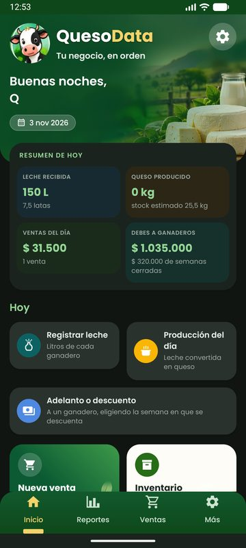
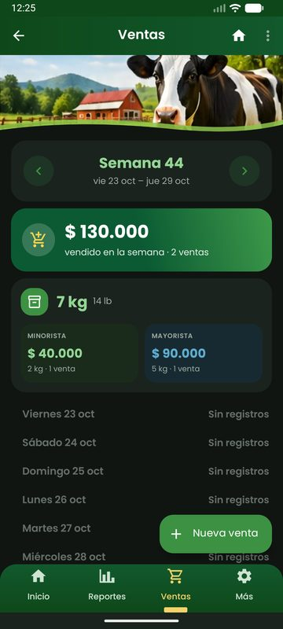
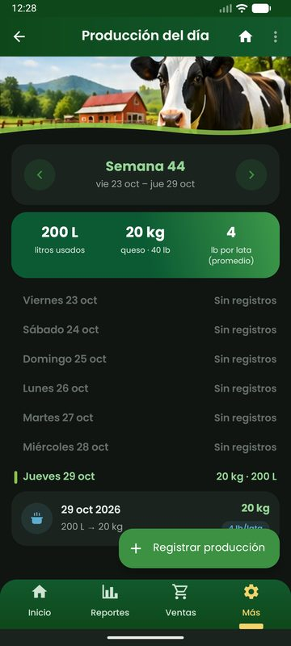
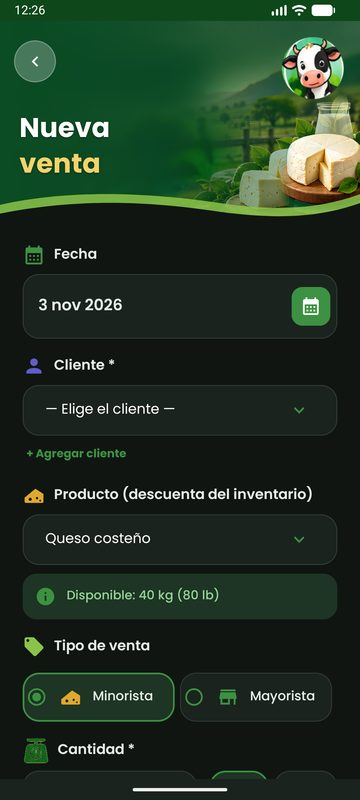
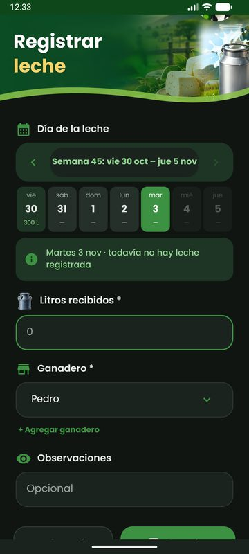
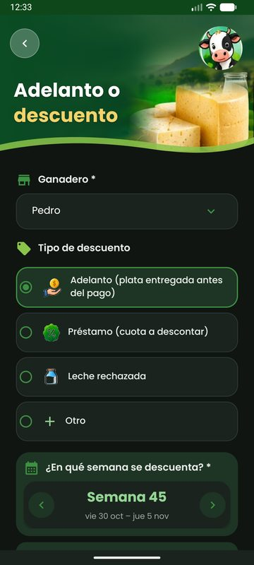

# QuesoData — Tu negocio, en orden

Aplicación Android para administrar una quesería pequeña: la leche que entregan los ganaderos, la
producción de queso, el inventario, las ventas, los clientes, los precios de cada semana y el pago
semanal a los ganaderos. Todos los datos se guardan en la nube, así que se pueden consultar desde
cualquier teléfono con la misma cuenta.

## El problema que resuelve

En muchas queserías las cuentas se llevan en cuadernos: cuántos litros trajo cada ganadero, cuánto
queso salió, a quién se le vendió y a qué precio. Al final de la semana hay que sumar todo a mano para
pagarle a cada ganadero y saber si el negocio ganó o perdió, y es fácil equivocarse o perder un dato.

QuesoData reemplaza ese cuaderno: se registra todo en el momento desde el celular y la app hace las
cuentas. La semana va de **viernes a jueves** (el jueves es el día de corte y de pago), y los totales
de ventas, producción, liquidaciones y reportes salen siempre de los mismos datos.

## Funciones principales

- **Leche recibida**: litros por ganadero y por día, con un calendario por semanas.
- **Producción**: litros usados y kilos de queso producidos, con el rendimiento en libras por lata.
- **Ventas**: minoristas y mayoristas a clientes registrados; el precio se pone solo con el de la semana.
  Resumen semanal con el total, los kilos y la separación mayorista/minorista, agrupado por día.
- **Inventario**: el stock de cada producto sube con la producción y baja con las ventas.
- **Precios por semana**: precio del queso (minorista y mayorista) y precio del litro de leche.
- **Liquidación semanal al ganadero**: litros, precio, adelantos y descuentos; comprobante en **PDF**
  que se comparte por WhatsApp; se marca como pagada con la fecha y la forma de pago.
- **Merma**: al cierre de la semana calcula el queso que se perdió.
- **Reportes y ganancias**: gráficos de las últimas 8 semanas (ventas, costo de la leche, ganancia,
  rendimiento y merma).
- **Cuenta**: registro, inicio de sesión, perfil del negocio, cambio de contraseña y modo claro/oscuro.

## Capturas de pantalla

| Inicio | Ventas de la semana | Producción de la semana |
|:---:|:---:|:---:|
|  |  |  |

| Nueva venta | Registrar leche | Adelanto o descuento |
|:---:|:---:|:---:|
|  |  |  |

*Capturas con datos de prueba, en modo oscuro.*

## Tecnologías

| Parte | Tecnología |
|---|---|
| App | **Kotlin**, Android (XML + ViewBinding, Navigation Component), corrutinas |
| Conexión con el servidor | **Retrofit** + Gson, sesión con JWT |
| Backend | **Node.js** + **Express** |
| Base de datos | **MongoDB Atlas** (Mongoose) |
| Hospedaje del backend | **Render** |
| PDF | `PdfDocument` de Android (se genera en el teléfono) |

## Arquitectura

```
┌──────────────────────┐   HTTPS + JWT    ┌──────────────────────────┐   Mongoose   ┌──────────────────┐
│   App Android        │ ───────────────▶ │  Backend Node/Express    │ ───────────▶ │  MongoDB Atlas   │
│   (Kotlin, Retrofit) │ ◀─────────────── │  (Render)                │ ◀─────────── │  (base de datos) │
└──────────────────────┘      JSON        └──────────────────────────┘              └──────────────────┘
```

- La **app** no tiene base de datos propia: cada pantalla consulta y guarda por la API. En el teléfono
  solo queda la sesión.
- El **backend** valida los datos, calcula semanas, liquidaciones, merma y reportes, y filtra todo por
  usuario: cada negocio ve solo su información.
- **MongoDB Atlas** guarda usuarios, ganaderos, leche, producción, productos, inventario, clientes,
  ventas, precios y liquidaciones.

Código del backend: **https://github.com/moisarteaga18-ux/queseria-backend**

### Organización del código de la app

```
app/src/main/java/com/queseria/app/
├── api/        Retrofit (RetrofitClient, QueseriaApi) y manejo de errores (ApiCall)
├── models/     Modelos de datos de la API
├── auth/       Sesión (SessionManager)
├── ui/         Pantallas por módulo: home (Inicio, leche, producción, ventas, precios),
│               ganaderos, clientes, productos, inventario, liquidaciones, merma, reportes,
│               cuenta, auth y common (formularios, calendario, listas por semana)
└── util/       Semanas de viernes a jueves, formatos, tema
```

## Cómo ejecutar la app

**Requisitos:** Android Studio (o el SDK de Android con JDK 17). La app funciona desde Android 8.0
(API 26).

1. Clonar el repositorio:
   ```
   git clone https://github.com/moisarteaga18-ux/queseria-app.git
   ```
2. Abrir la carpeta en Android Studio y esperar a que Gradle sincronice.
3. Ejecutar en un emulador o teléfono con **Run ▶**, o compilar el APK desde la terminal:
   ```
   ./gradlew assembleDebug
   ```
   El APK queda en `app/build/outputs/apk/debug/app-debug.apk`.
4. Crear una cuenta en la pantalla de registro e iniciar sesión.

Por defecto la app usa el backend publicado en Render (`https://queseria-backend.onrender.com/api/`).
En el plan gratuito de Render el servidor se duerme cuando no se usa, así que la primera petición
puede tardar unos segundos.

### Probar con un backend local

Con el [backend](https://github.com/moisarteaga18-ux/queseria-backend) corriendo en el computador
(`node src/index.js`, puerto 3000), se compila la app apuntando a él (en el emulador, `10.0.2.2` es
el computador):

```
./gradlew assembleDebug -PapiUrl=http://10.0.2.2:3000/api/
```

### Pruebas unitarias

```
./gradlew testDebugUnitTest
```
